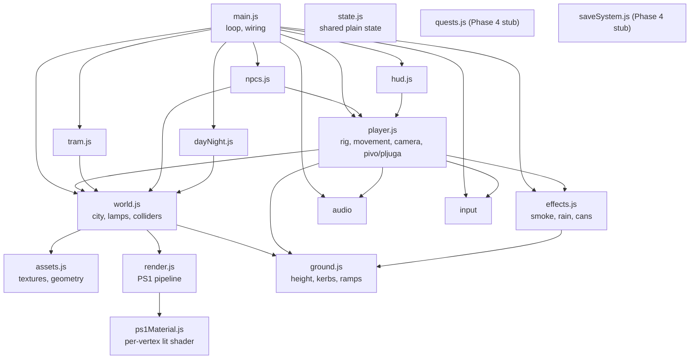

# Novi Beograd — noć

A PS1-style walking simulator set in the brutalist blocks of Novi Beograd. All meshes,
textures, audio and music are generated in code.

## Play

```bash
npm install
npm run dev
```

Then open http://localhost:5173 and click to start.

| Key | Action |
| --- | --- |
| WASD / arrows | Walk (Shift: faster) |
| Mouse / touch drag | Orbit camera |
| E / 1 | Pivo (beer) |
| Q / 2 | Pljuga (cigarette) |
| T / 3 | Day / night |
| M | Music on / off |

`npm run build` writes a static site to `dist/`. `npm test` runs the unit tests.

The original single-file demo is kept untouched at `legacy/index.html` (open it directly
in a browser). It is the visual reference the modular version is checked against.

## What's in it

- 320×240-class render target, vertex snapping, ordered dither and 15-bit colour, CRT overlay
- Per-vertex lighting, pooled sodium lamps with wet-ground reflections
- Tram, parked Yugos, K67 kiosks, graffiti
- Landmarks on a minimap: Genex, Ušće, Rudo, Hram Svetog Save, Avala tower, Palata Srbije
- Pedestrians who greet you by time of day; optional real recordings in `public/voices/`
  (for example `public/voices/dobro_vece.mp3`)
- Procedural Web Audio: footsteps, wind, hum, tram clatter and a slow minor-key waltz

## Architecture

Three.js 0.187 + Vite 8. Roadmap: [docs/ROADMAP.md](docs/ROADMAP.md).



Things to know before changing code:

- **The city is built from a seeded random generator.** Modules consume it in a fixed
  order (assets, world, tram, pedestrians). Calling `R()`, `rr()` or `pick()` earlier, or
  reordering the imports in `main.js`, moves every building, car and tree.
- **`ps1Material.js` and `render.js` define the look.** The lit material reproduces
  Three.js r128's per-vertex Lambert shading and light falloff, colour management is off,
  and the render target uses 16-bit depth. Each of those was needed to match the original
  frame for frame.
- **Two height functions.** `gY(z)` is where static things were placed (a hard step at the
  kerb; never change it). `groundHeight(x, z)` is where a walker should stand: continuous,
  with a sloped kerb and inclines registered through `addRamp()` for stairs, underpasses
  and overpasses.
- **Variable timestep.** Every system scales by the frame time (capped at 50 ms), so speed
  is the same at any refresh rate; movement sub-steps on slow frames.

## Checking the look

After any change to rendering, lighting, materials or a Three.js upgrade:

```bash
node tools/make-legacy-debug.mjs
npm run dev
```

1. Open `http://localhost:5173/__legacy/index.html`, load `/__legacy/lookcheck.js` from the
   console (`import('/__legacy/lookcheck.js')`), then run `__cap('ref')` and
   `__full('refFull', [-4, 17, -1.5708, 0.36, 0])`.
2. Open `http://localhost:5173/`, load the same script, run `__cap('new')` and
   `__full('newFull', [-4, 17, -1.5708, 0.36, 0])`.
3. `__diff('ref', 'new')` compares seven camera positions (five night, two day);
   `await __fullDiff('refFull', 'newFull')` counts differing pixels in a full frame.

Baseline on 2026-11-15 (Three.js 0.187, Chromium): full frame differs in 5 of 76,800 pixels
at night and 1 by day, none by more than 16 levels.
